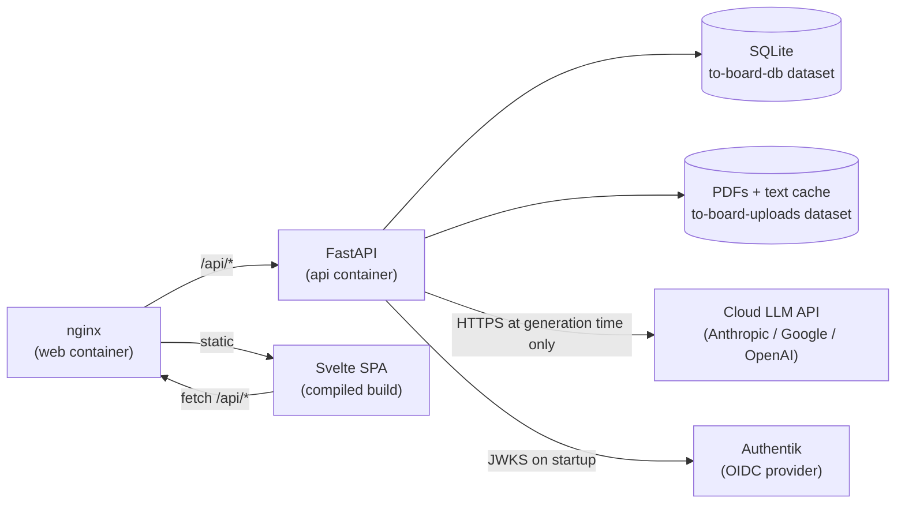
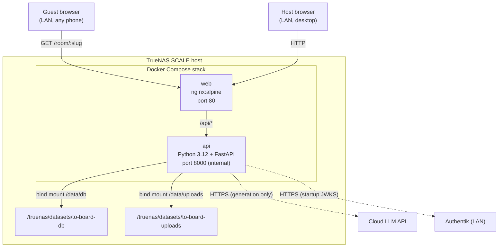
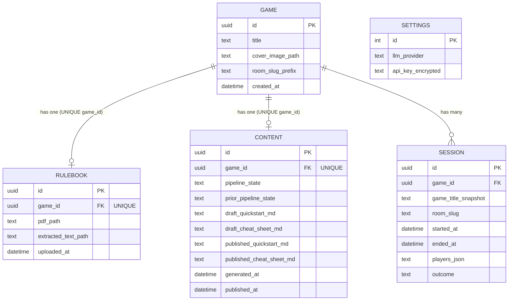

# Architecture Spine — to-board

## Design Paradigm

**Layered monolith with compiled frontend.** The backend is a single Python process (FastAPI) that owns all business logic, data access, and background work. The frontend is a compiled Svelte SPA — static files at build time, no server-side rendering. nginx sits in front: serves the compiled SPA and reverse-proxies `/api/*` to FastAPI.

Layer map:

```
nginx (container: web)
├── /              → static Svelte build (frontend/dist/)
└── /api/*         → FastAPI (container: api)
                      ├── routers/        (HTTP surface — one per domain)
                      ├── services/       (business logic, state machine)
                      ├── models/         (SQLModel table + schema definitions)
                      ├── workers/        (background tasks: extraction, generation)
                      └── db/             (SQLite session, engine setup)
```

Dependency direction: routers → services → models/workers → db. Workers may call services to persist results. Nothing flows upward.



---

## Invariants & Rules

### AD-1 — Application paradigm: Python backend + compiled Svelte frontend

- **Binds:** all features
- **Prevents:** Node.js backend (PDF extraction requires Python); SSR in the frontend (unnecessary complexity for a LAN-only app); two backend languages
- **Rule:** The backend is Python-only (FastAPI + Uvicorn). The frontend is a compiled Svelte SPA served as static files by nginx. No Node.js process runs at runtime. The monorepo has exactly two top-level subdirectories: `backend/` and `frontend/`.

### AD-2 — Database: SQLite, single file, SQLModel ORM

- **Binds:** FR-1, FR-2, FR-4, FR-5, FR-7, FR-9, FR-10, FR-15, FR-16, FR-17, FR-18
- **Prevents:** two data stores; PostgreSQL (no justification for single-user max-8-guest load); raw sqlite3 (no type safety)
- **Rule:** All structured data is stored in a single SQLite file at `/data/db/to-board.db`. All access goes through SQLModel models. No second database engine is permitted.

### AD-3 — Persistent storage: two named TrueNAS datasets, never Docker volumes

- **Binds:** NFR-4, FR-2, FR-6, FR-15, FR-18
- **Prevents:** any persistent file written to a Docker-managed volume (lost on container rebuild)
- **Rule:** Two bind mounts, one per dataset:
  - `to-board-db` → `/data/db/` — SQLite file
  - `to-board-uploads` → `/data/uploads/` — raw PDFs and extracted-text cache (`.txt` files alongside PDFs)
  
  Everything written at runtime goes under one of these two paths. No `volumes:` key in `docker-compose.yml` for persistent data.

### AD-4 — Content stored as Markdown text in SQLite

- **Binds:** FR-5, FR-7, FR-8, FR-13
- **Prevents:** content as separate files on the dataset (adds file path management, harder to query pipeline state); HTML (XSS risk from LLM output)
- **Rule:** The `Content` table has `quickstart_md TEXT` and `cheat_sheet_md TEXT` columns. The LLM is instructed to return Markdown. The frontend renders Markdown to HTML client-side. Content is human-editable directly in SQLite via DB Browser for SQLite if a manual fix is needed.

### AD-5 — Pipeline state machine enforced server-side only

- **Binds:** FR-5, FR-7, FR-10, FR-14, and all Content pipeline handling
- **Prevents:** frontend asserting state transitions; two units independently managing the pipeline and diverging; multiple `published` rows per game
- **Rule:** All `Content.pipeline_state` transitions are validated and executed in `backend/services/content.py`. Invalid transitions return HTTP 409. The frontend reads state from `GET /api/games/:id`; it never writes a state value directly.

  Transition ownership (prevents double-fire):
  - `no_rulebook → extracting`: fired by the **upload service** before enqueuing the extraction worker. The extraction worker MUST NOT re-fire this transition.
  - All other transitions: fired by the relevant service on behalf of the triggering actor (Host action or background worker result).

  CONTENT cardinality: exactly one CONTENT row per game (UNIQUE on `game_id`). The row carries two Markdown column pairs — `draft_*` (nullable, written on generation, cleared on reject) and `published_*` (nullable, copied from draft on publish, never cleared). Guest content is served from the `published_*` columns. The `pipeline_state` column reflects the active operation; the `published_*` columns are independent of state and survive a regeneration cycle intact until a new publish overwrites them.

  Valid transitions:

```mermaid
stateDiagram-v2
    [*] --> no_rulebook
    no_rulebook --> extracting : upload service (rulebook uploaded)
    extracting --> ready_to_generate : extraction worker complete
    extracting --> no_rulebook : extraction worker failed
    ready_to_generate --> generating : Host triggers generation
    generating --> draft : LLM returns content (draft_* columns populated)
    generating --> ready_to_generate : LLM call failed
    draft --> published : Host publishes (draft_* copied to published_*; draft_* cleared)
    draft --> rejected : Host rejects (draft_* cleared)
    rejected --> generating : Host triggers regeneration
    published --> generating : Host triggers regeneration (published_* untouched; draft_* cleared)
```



### AD-6 — Background job model: in-process async, no separate worker

- **Binds:** FR-5, FR-6 (PDF extraction + LLM generation)
- **Prevents:** Celery, Redis, or any separate worker container (overkill for single-user load); ambiguous stuck-job recovery; extraction worker writing to a path the generation worker cannot find
- **Rule:**
  - PDF extraction (`pdfplumber`) runs in a thread pool via `asyncio.run_in_executor(None, ...)` — it is synchronous blocking I/O.
  - LLM generation runs as `asyncio.create_task(...)` — fully async HTTP.
  - Both are initiated via FastAPI `BackgroundTasks` on the triggering request.
  - `CONTENT.prior_pipeline_state TEXT` is written on every state transition (the state being left). This is the authoritative record for stuck-job recovery; hardcoded predecessor assumptions are forbidden.
  - The extraction worker MUST write the absolute path of the produced `.txt` file to `RULEBOOK.extracted_text_path` before transitioning `pipeline_state` to `ready_to_generate`. The LLM generation worker MUST read extracted text exclusively from `RULEBOOK.extracted_text_path`; direct path reconstruction from IDs is forbidden.
  - **Stuck-job recovery:** on FastAPI startup, each `Content` row with `pipeline_state IN ('extracting', 'generating')` is reset to `prior_pipeline_state`. The Host re-triggers.

### AD-7 — Real-time model: SSE for Guest session-end only; polling for pipeline state

- **Binds:** FR-14 (session-end notification), FR-5 / FR-6 (pipeline state updates)
- **Prevents:** WebSocket (bidirectional, no server-to-client use case beyond session-end); polling for session-end (Guest must see the closed notice without a manual refresh)
- **Rule:**
  - `GET /api/room/:slug/events` holds one SSE connection per connected Guest. On session-end, the server pushes `event: session-ended` and closes the stream.
  - Pipeline state updates (extraction, generation) are delivered via the Svelte frontend polling `GET /api/games/:id` at ≤5 s while `pipeline_state` is `extracting` or `generating`. No SSE stream for the Host.

### AD-8 — Auth boundary: Authentik OIDC on Host routes; Guest routes open

- **Binds:** all routes; FR-12 (no Guest auth), NFR-7 (no Guest data)
- **Prevents:** building a login screen in to-board; protecting Guest routes; leaking the API key to the frontend
- **Rule:**
  - Every Host route (`/api/games/*`, `/api/sessions/*`, `/api/settings/*`) depends on `Depends(require_host)` — a FastAPI dependency that validates the OIDC JWT from the `Authorization` header against Authentik's JWKS endpoint (cached on startup, refreshed on key rotation).
  - Guest routes (`GET /api/room/:slug`, `GET /api/room/:slug/events`) have no auth dependency. No Guest identity is stored.
  - Provider selection and the encrypted LLM API key are stored in the singleton SQLite `Settings` row. The key is never returned in any API response and never included in the compiled frontend bundle. Model IDs are server-side environment configuration.
  - Encryption uses `cryptography.fernet.Fernet` exclusively. The Fernet key is read from env var `SECRET_KEY` (32-byte URL-safe base64). Encryption and decryption are implemented exactly once in `backend/core/crypto.py` (`encrypt_api_key()` / `decrypt_api_key()`). All other modules call these functions; inline crypto is forbidden.

### AD-9 — Rulebook cardinality: one active Rulebook per Game

- **Binds:** FR-2, FR-6 (upload + extraction)
- **Prevents:** two Rulebook rows for the same Game causing the generation worker to pick the wrong one
- **Rule:** `RULEBOOK` has a UNIQUE constraint on `game_id` — exactly one row per Game. On re-upload, the upload service deletes the old RULEBOOK row and its associated files (`pdf_path`, `extracted_text_path`) from `/data/uploads/` before inserting the new row. The delete and insert happen in the same DB transaction. The generation worker selects the Rulebook by `game_id`; selecting by `game_id` always returns exactly one row.

---

## Consistency Conventions

| Concern | Convention |
|---|---|
| **Naming — files** | `backend/`: `snake_case.py`. `frontend/`: `PascalCase.svelte` for components, `camelCase.ts` for utilities |
| **Naming — API routes** | REST, JSON. Host: `/api/games`, `/api/sessions`, `/api/settings`. Guest: `/api/room/:slug`, `/api/room/:slug/events`. Verbs via HTTP method; no `/api/games/delete` |
| **Naming — domain nouns** | Use PRD §4 Glossary terms verbatim in code: `Game`, `Rulebook`, `Content`, `PipelineState`, `Session`, `Room`. Never "project", "document", "user" |
| **IDs** | UUID v4 for `Game.id` and `Session.id`. Room slug format: `<game-slug>-<4-char-base36>` generated at Session creation (e.g. `wingspan-3f2a`) |
| **room_slug_prefix** | `GAME.room_slug_prefix` is a URL-safe slugification of `GAME.title` (lowercase, spaces→hyphens, non-ASCII stripped, max 32 chars). Written by the game-creation service at INSERT time and immutable thereafter. Session-creation service appends `-<4-char-base36>` to produce `SESSION.room_slug`. Slugification is implemented once in `backend/core/utils.py:slugify()` |
| **Dates / timestamps** | ISO 8601 UTC strings in API responses (`created_at`, `started_at`, `ended_at`). SQLite stores as TEXT |
| **Error shape** | `{"detail": "<human-readable message>"}` — FastAPI default. HTTP 409 for invalid pipeline transitions; 422 for validation errors; 404 for missing resources |
| **State mutation** | Only `backend/services/` layer mutates `pipeline_state`. Routers call services; workers call services to write results. No direct DB writes from routers or workers |
| **Config** | Runtime config (dataset paths, Authentik issuer URL, and provider model IDs) comes from environment variables read at startup. The selected LLM provider is persisted in `Settings`. No hardcoded paths. `backend/core/config.py` is the single config object |
| **No Guest data** | No logging middleware that records request IPs. No analytics. Guest SSE connections are tracked in-memory only (no DB write); the tracking structure stores only the asyncio Queue, not the client IP |
| **Markdown rendering** | Frontend uses a single shared `<Markdown>` Svelte component (wrapping a lightweight library, e.g. `marked`) for all content rendering. Sanitization applied before render |

---

## Stack

| Name | Version |
|---|---|
| Python | 3.12 |
| FastAPI | 0.141.1 |
| Uvicorn | 0.52.4 |
| SQLModel | 0.0.42 |
| SQLite | built-in (Python stdlib) |
| pdfplumber | 0.11.10 |
| Svelte | 5.57.0 |
| Vite | 8.2.2 |
| TypeScript | latest compatible with Svelte 5.57.0 |
| pdfjs-dist | 6.3.289 (bundled in frontend) |
| nginx | 1.27-alpine |
| Docker Compose | v2 (TrueNAS SCALE built-in) |
| TrueNAS SCALE | host OS (x86-64, Linux) |

---

## Structural Seed

### Repository layout

```text
to-board/
  backend/
    core/
      config.py        # env-var paths, OIDC issuer, and provider model IDs; provider selection is persisted in Settings
      crypto.py        # Fernet encrypt_api_key() / decrypt_api_key() — only crypto impl
      utils.py         # slugify() and other shared utilities
    routers/
      games.py         # /api/games — CRUD + pipeline triggers
      sessions.py      # /api/sessions — CRUD + end-session
      room.py          # /api/room/:slug — Guest content + SSE
      settings.py      # /api/settings — API key management
    services/
      content.py       # pipeline state machine + generation orchestration
      extraction.py    # PDF text extraction (pdfplumber, run_in_executor)
      llm.py           # LLM API client (Anthropic / Google / OpenAI)
      auth.py          # OIDC JWT verification (require_host dependency)
    models/
      game.py          # Game, Rulebook SQLModel tables
      content.py       # Content table (pipeline_state, quickstart_md, cheat_sheet_md)
      session.py       # Session table (room_slug, started_at, ended_at, players, outcome)
      settings.py      # Settings table (encrypted API key, provider)
    workers/           # background task functions called via BackgroundTasks
      extraction.py
      generation.py
    db/
      engine.py        # SQLite engine + session factory
      init.py          # create_all on startup; stuck-job recovery
    main.py            # FastAPI app, router includes, lifespan handler
    Dockerfile
  frontend/
    src/
      lib/
        api.ts          # typed fetch wrappers for /api/*
        Markdown.svelte # shared Markdown renderer (marked + sanitize)
      routes/           # page components matching the IA (Collection, GameDetail, etc.)
      components/       # GameCard, StatusBadge, Sidebar, QRReveal, RoomPage, etc.
      app.ts            # Svelte app entry
    public/
      pdf.worker.mjs    # PDF.js worker (copied at build time)
    vite.config.ts
    Dockerfile          # builds static dist/; final image is nginx:alpine
  docker-compose.yml    # two services: api, web; two bind mounts; no managed volumes
  .env.example          # DB_PATH, UPLOADS_PATH, OIDC_ISSUER, provider model IDs, etc.
```

### Container topology



### Core entity relationships



---

## Capability → Architecture Map

| Capability / FR | Lives in | Governed by |
|---|---|---|
| FR-1 Create game | `routers/games.py` → `services/` → `models/game.py` | AD-2, AD-5, conventions (naming, IDs) |
| FR-2 Upload rulebook PDF | `routers/games.py` + `workers/extraction.py` | AD-3 (uploads dataset), AD-6 (thread pool), AD-5 |
| FR-3 PDF viewer (PDF.js) | `frontend/src/routes/GameDetail` + PDF.js | AD-1 (frontend-only feature), PRD A-13 |
| FR-4 Delete game | `routers/games.py` → `services/` | AD-2, AD-3 (delete file + DB row) |
| FR-5 Trigger generation | `routers/games.py` → `services/content.py` → `workers/generation.py` | AD-5 (state machine), AD-6 (async task), AD-8 (Host only) |
| FR-6 PDF text extraction | `workers/extraction.py` (`run_in_executor`) | AD-6, AD-3 (text cache in uploads) |
| FR-7 Review Draft content | `routers/games.py` → `services/content.py` | AD-4 (Markdown), AD-5 (state machine) |
| FR-8 Serve Published content from local storage | `routers/room.py` reads SQLite | AD-4, AD-2; zero cloud calls at runtime |
| FR-9 Configure API key | `routers/settings.py` → `models/settings.py` | AD-8 (key encrypted in DB, never in response) |
| FR-10 Start session | `routers/sessions.py` → `services/` | AD-5, AD-2; room_slug generated here |
| FR-11 QR code generation | `frontend/src/routes/QRReveal` (client-side QR lib) | AD-1 (frontend feature) |
| FR-12 Guest accesses Room | `routers/room.py` (no auth dependency) | AD-8 (no auth), NFR-7 (no Guest data) |
| FR-13 Room page content display | `frontend/src/routes/RoomPage` | AD-1, AD-4 (Markdown rendered client-side) |
| FR-14 Host ends session; Guest notified | `routers/sessions.py` → SSE close event | AD-7 (SSE only for session-end) |
| FR-15–18 Session log / persistence | `models/session.py`, `to-board-db` dataset | AD-2, AD-3 (NFR-4 durability) |
| FR-19–20 Host preview / PDF viewer without session | `routers/games.py` GET content + PDF viewer route | AD-8 (Host auth), no Session dependency |
| NFR-1/2/3 Performance | Content served from SQLite (no cloud); static SPA; ≤8 SSE connections | AD-7, AD-8 |
| NFR-4 Data durability | Named TrueNAS bind mounts | AD-3 |
| NFR-5 Resource ceiling | Single Python process + nginx alpine; SQLite | AD-1, AD-6 (no Redis/Celery) |
| NFR-6 Single-stack deployment | `docker-compose.yml` with 2 services | AD-1 |
| NFR-7 Guest privacy | No auth on Guest routes; no logging of Guest identity | AD-8, conventions |

---

## Deferred

- **HTTPS / TLS termination:** PRD A-11 defers this. The Compose stack listens on HTTP port 80. Reverse-proxy TLS (e.g., Caddy, Nginx Proxy Manager on TrueNAS) is a host-level concern, not decided here.
- **LLM provider selection and model configuration:** The Host selects Anthropic, Google, or OpenAI in Settings; provider selection and the encrypted API key persist in the singleton Settings row. Model IDs are configured server-side with `ANTHROPIC_MODEL`, `GOOGLE_MODEL`, and `OPENAI_MODEL`.
- **Cover image storage:** PRD FR-1 allows an optional cover image. Storage path (`/data/uploads/covers/`) and serving approach (direct nginx static serve vs. API route) deferred to the Game Collection epic.
- **PDF.js version pinning and worker bundling:** version 4.x specified; exact patch version and the Vite plugin used to copy the PDF.js worker are deferred to the PDF Viewer epic.
- **Markdown sanitization library:** the `<Markdown>` component must sanitize LLM output before render; specific library choice (`dompurify`, `isomorphic-dompurify`, or `marked`'s built-in sanitizer) deferred to the Content Review epic.
- **LLM prompt versioning:** the prompts sent to the cloud LLM for Quick-start Guide and Cheat Sheet generation are not fixed here. Prompt content and token limits are deferred to the Generation epic.
- **Play Mode (v1.1):** deferred per UX spine — no surfaces in v1.
- **v1.1 features:** content quality voting, Cheat Sheet deep-links to PDF, private phone view, session photos — all deferred per PRD §7.1.
